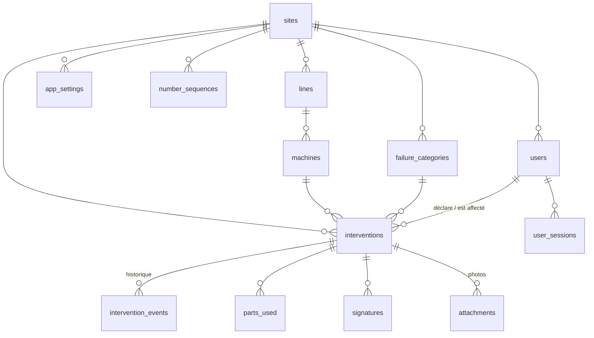

# Modèle de données

Migration : `backend/alembic/versions/0001_schema_initial_phase_1.py` (`alembic upgrade head`).
Toutes les dates sont en UTC (`timestamptz`) et affichées dans le fuseau du site (Africa/Tunis par défaut).

| Table | Rôle | Points clés |
|---|---|---|
| `sites` | Usine | prépare le multi-usines ; fuseau horaire |
| `users` | Comptes | rôle `CHEF_EQUIPE`/`TECHNICIEN`/`RESPONSABLE`/`ADMIN`, hash bcrypt, verrouillage, changement forcé |
| `user_sessions` | Sessions | révocation à la déconnexion |
| `lines`, `machines` | Référentiel | `machines.qr_token` : jeton opaque pour le QR Code (phase 2) |
| `failure_categories` | Types de panne | priorité par défaut |
| `number_sequences` | Compteur annuel par site | verrou de ligne → BI-AAAA-NNNNNN sans doublon |
| `interventions` | Bon | état, priorité, horodatages de chaque étape, rapport technique, `client_uuid` (idempotence hors ligne), `version` (verrou optimiste), `revision`, empreinte et chemin du PDF archivé |
| `intervention_events` | Historique | ajout seul : type, état avant/après, auteur, commentaire, détail JSON (ancien/nouveau) |
| `parts_used` | Pièces | référence, désignation, quantité, unité (extensible vers un module stock) |
| `signatures` | Signatures | rôle (MAINTENANCE / RESPONSABLE / PRODUCTION), image PNG, empreinte SHA-256 du contenu signé, révision, `superseded` |
| `attachments` | Photos | type (PROBLEME / AVANT / APRES), SHA-256, chemin de stockage |
| `audit_log` | Journal d'audit | ajout seul : connexions, échecs, actions, exports PDF, administration |
| `app_settings` | Paramètres par site | validation Responsable, seuils de retard et de récurrence, nom affiché |

## Protections au niveau base (triggers)

- `DELETE` interdit sur `interventions`, `intervention_events`, `signatures`, `attachments`, `audit_log`.
- `UPDATE` interdit sur `intervention_events` et `audit_log`.
- Un bon `CLOTURE` ou `ANNULE` ne peut plus être modifié (seuls les champs d'archivage PDF peuvent être
  renseignés une seule fois ; la réouverture change l'état et est donc autorisée).
- Un bon annulé ne peut pas être réactivé.
- Pièces d'un bon clôturé non modifiables.

Ces protections sont vérifiées par `tests/test_security.py::test_database_forbids_silent_deletion_and_closed_edits`.
Un propriétaire de base peut toujours tout contourner (TRUNCATE, DROP) : en production, l'API utilise un rôle
restreint (`deploy/db_least_privilege.sql`).

## Base locale Android (Room)

| Table | Rôle |
|---|---|
| `cache` | JSON des référentiels, listes et fiches consultées (lecture hors ligne) |
| `pending_tickets` | bons créés hors connexion : requête complète + photos, envoyés par `SyncWorker` |
